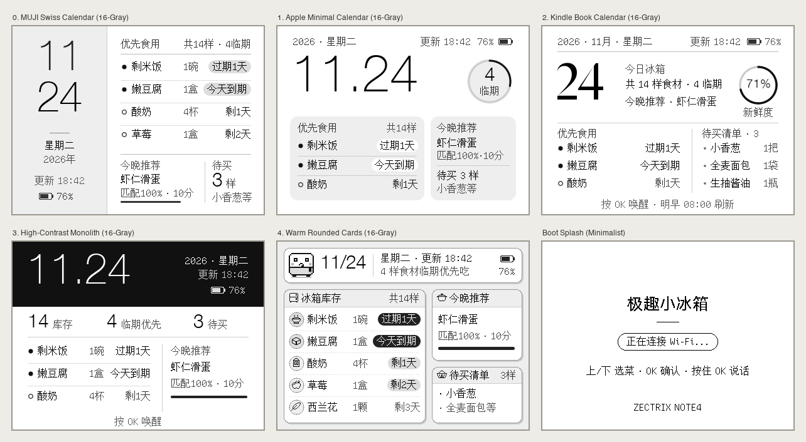
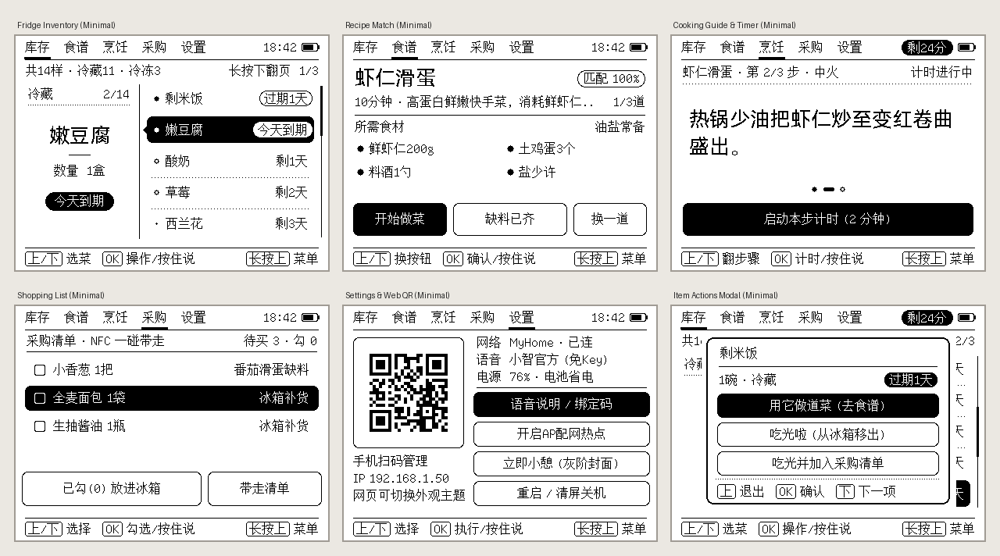
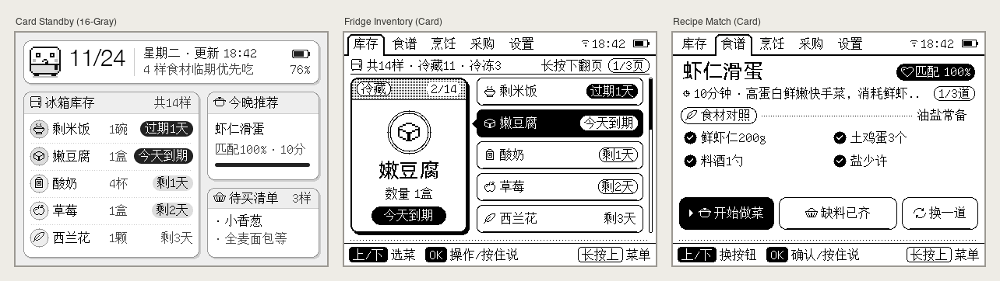

# 极趣小冰箱 · ZECTRIX NOTE4 墨水屏固件发布（Firmware Releases）

面向 **ZECTRIX NOTE4**（ESP32-S3 · 4.2 寸 400×300 黑白 / 16 灰阶电子墨水屏）的智能冰箱库存、菜谱推荐、烹饪引导、购物清单与语音助手固件预编译发布仓库。

> 本仓库仅提供**脱敏预编译成品固件**与刷机使用指南（不含源代码）。固件默认不包含任何预置 Wi-Fi 密码，首次刷机后自动开启独立随机密码配网热点。

---

## 核心特性

- **全机双主题同步换肤（手机网页一键切换，立即全刷生效）**
  - **极简高级风**（默认）：MUJI / Apple / Kindle 视觉体系，去杂纹、大留白、细线下划线页签与纯粹瑞士网格排版，从待机到交互与弹窗零割裂。
  - **温馨圆角卡片风**：保留 13 套手绘像素食材图标与温暖手账圆角卡片手感，配套精修无割裂 16 灰阶卡片待机海报。
- **5 套真 16 灰阶（4bpp）抗锯齿待机封面 & 3 分钟防残影自动休眠**
  - 全部采用**大号抗锯齿日期主角 + 均衡黑白灰层级 + 小字更新时间戳**（每天早起自动刷新一次全天不穿帮）；电池供电时无操作 **3 分钟**自动全刷回到 16 灰阶待机封面并深睡停止局刷，唤醒交互期同步收紧局刷次数自动全刷清残影。可在手机网页「设置」中随时切换：`MUJI 瑞士双栏日历`、`Apple 极简大日历`、`Kindle 单向历书页`、`原研哉 黑白撞色海报`、`温馨圆角卡片看板`。
- **库存管理 + 长按下键整页连翻**
  - 支持最多 **80 样**食材；绝不虚构保质期（未设到期天数时如实显示「今天放入 / 已放 N 天」）。
  - 左焦详情 + 右列 5 项清单，食材超过 5 样时**按住下键即可连续整页翻页**、松手即停不冲过头。
- **今日食谱 & 29px 大字烹饪引导**
  - 自动比对冰箱库存并优先消耗临期食材，支持一键把缺料加入采购清单。
  - 烹饪页原生 29px 大字步骤引导，内置厨房倒计时（仅局部静默刷新右上角胶囊，不闪烁全屏，到点响铃并可语音播报）。
- **采购清单带走：NFC 一碰直达 + 二维码兜底 + 一键排版购物卡**
  - 联网后自动将本机采购页写入板载 NT3H NFC 标签并立即断电省电；iPhone / Android 一碰直达采购清单。
  - 兼容无 NFC 硬件批次及离线环境：按「带走清单」自动弹出二维码（离线模式下生成纯文本清单码，微信扫码即可复制转发）。
  - 手机网页内置**一键生成排版购物卡 PNG 图片**（长按存相册，进超市断网也能看）与**一键复制清单**。
- **小智语音助手（免 API Key）**
  - 按住 `OK` 键听「叮」后自然说中文（例如：“放两盒牛奶 5 天过期，排骨放冷冻”、“番茄吃完了，顺手把小葱加采购单”、“定时 15 分钟”、“用冰箱里的菜推荐一道快手菜”），支持语音回复播报与一键撤销。
  - 默认直连公开免费小智云端（`xiaozhi.me`，免充值免 Key），也可在网页设置中改连自家局域网私有小智服务。

---

## 界面实机像素预览

### 5 套 16 灰阶待机封面 & 开机页


### 极简高级风（全机交互页与弹窗同步）


### 温馨圆角卡片风（待机与内页同步）


---

## 固件下载

请前往右侧 **[Releases](../../releases)** 页面下载最新版本的固件文件：

| 文件名 | 烧录起始地址 | 适用场景 |
| :--- | :---: | :--- |
| `zectrix-fridge-v0.0.3-merged-0x0.bin` | `0x0` | **首次安装 / 全新刷入（推荐）**：单文件已合并 bootloader、分区表与主程序 |
| `zectrix-fridge-v0.0.3-app-0x20000.bin` | `0x20000` | **老版本升级**：仅覆盖应用分区，保留你已有的冰箱库存、菜谱与 Wi-Fi 配置 |
| `SHA256SUMS.txt` | — | 固件 SHA-256 校验值 |

---

## 刷机教程

> **重要提醒**：刷入第三方固件前，**强烈建议先用 `esptool` 备份原厂完整 16MB Flash**，以便随时无损恢复原厂固件：
> ```bash
> esptool.py --chip esp32s3 -p <你的串口> -b 460800 read_flash 0x0 0x1000000 note4-factory-backup-16mb.bin
> ```

### 方式一：命令行 `esptool` 刷入（macOS / Linux / Windows 通用）

1. 用支持数据传输的 USB-C 线连接 ZECTRIX NOTE4 到电脑（若设备正处于深度休眠，先短按一下 `OK` 键唤醒）。
2. 安装 `esptool`（若尚未安装）：
   ```bash
   pip install esptool
   ```
3. **首次全新刷入**（从 `0x0` 写入合并包）：
   ```bash
   esptool.py --chip esp32s3 -p <你的串口> -b 460800 \
     --before default_reset --after hard_reset \
     write_flash --flash_mode dio --flash_size 16MB --flash_freq 80m \
     0x0 zectrix-fridge-v0.0.3-merged-0x0.bin
   ```
   *(若已刷过本固件旧版本，仅升级主程序并保留库存数据，把最后一行换成 `0x20000 zectrix-fridge-v0.0.3-app-0x20000.bin` 即可。)*

> **常见串口名称**：macOS 一般为 `/dev/cu.usbmodem*`，Windows 为 `COM3` / `COM4` 等，Linux 为 `/dev/ttyACM0`。

### 方式二：浏览器图形化工具（免装 Python）

可使用任意支持 ESP32-S3 的网页烧录器（Chrome / Edge 打开 ESP Web Tool 或乐鑫 Flash Download Tool）：
- 芯片选择 **ESP32-S3**，Flash 模式 **DIO**，频率 **80MHz**，容量 **16MB**
- 填入烧录地址 **`0x0`**，选择下载的 `zectrix-fridge-v0.0.3-merged-0x0.bin`，点击烧录即可。

---

## 首次开机配网与使用

1. **连接配网热点**：首次开机未配置 Wi-Fi 时，设备会自动开启专属配网热点 `ZecTrix-Fridge`（每台设备首次开机随机生成独立 8 位密码，显示在「设置」页左侧，也可手机直接扫屏幕二维码连接）。
2. **配置家庭 Wi-Fi**：连上热点后，手机浏览器打开 `http://192.168.4.1/`，切到 **「设置」** 填写家庭 **2.4GHz Wi-Fi** 名称与密码并保存。
3. **日常管理与换肤**：连入家庭 Wi-Fi 后，屏幕「设置」页会展示局域网二维码（或直接手机轻碰设备 NFC），浏览器打开即可管理库存、生成排版购物卡图片，以及一键切换 **2 套整机风格** 与 **5 套 16 灰阶待机封面**。

---

## 实体按键速查

| 场景 | `上键` | `下键` | `OK 键` |
| :--- | :--- | :--- | :--- |
| **顶部菜单栏**（页签反黑） | 上一个页面 | 下一个页面 | 进入当前页面 |
| **页面内部** | 上一项（到顶自动回菜单）；**长按 0.6 秒**回菜单 | 下一项；多页列表**长按连续整页翻页** | 确认 / 弹窗 / 勾选 |
| **任意界面** | — | **长按 3 秒**进入 16 灰阶待机小憩（多页列表内防误触） | **按住 0.35 秒**听「叮」后语音对话 |
| **深度小憩休眠中** | — | 短按唤醒 | 短按唤醒 |

---

## 致谢与声明

- 底层 ESP32-S3 墨水屏及板级驱动基于 Zectrix Lab 的 MIT 开源驱动，谨致谢意（详见 [LICENSE](LICENSE)）。
- 本固件为个人兴趣与体验分享发布，请务必在刷机前自行备份原厂镜像；因不当操作造成的硬件或数据损失需自行承担。
